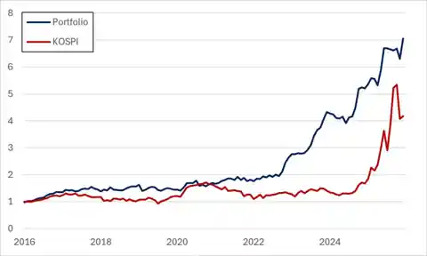
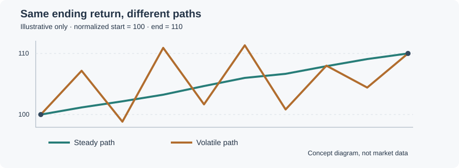
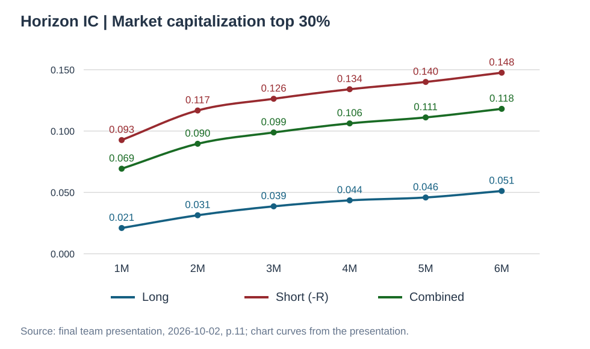
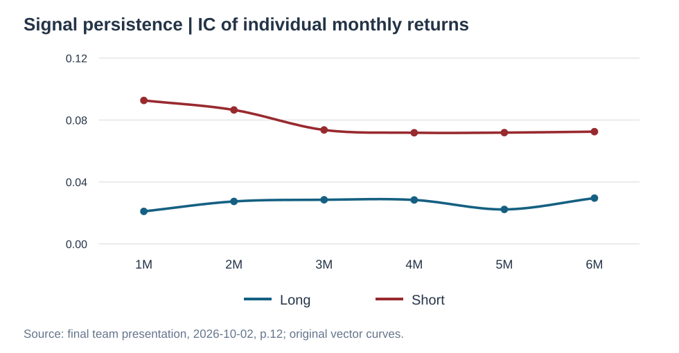

# 최종 전략 | Price Asymmetric Strategy (PAS)

> QUANTIFI · 2026 Fall · 최종 팀 투자제안서 · 2026.10.02

> **연구 질문:** 하나의 가격 시계열에서 네 가지 통계적 특성을 추출하고 목적에 맞는 판단 규칙으로 결합할 수 있는가?

[Python 구현 코드](backtest.ipynb) · [데이터 및 방법론](#problem--data-workflow) · [연구 한계](#limitations--reproducibility) · [대표 차트](assets/)

## 연구 질문

1. 동일한 수익률을 기록한 종목의 가격 경로 차이를 어떤 통계량으로 구별할 수 있는가?
2. 네 통계량을 비교 가능한 순위로 변환하고 롱·숏 규칙에 어떻게 결합할 것인가?
3. 점수의 예측력과 유지 기간, 거래 가능성을 어떤 실험으로 검증할 것인가?

## 최종 발표 성과

**2016.09.01–2026.08.31 · 120개월 · 분기 리밸런싱 · 거래비용 왕복 50bp**

*2026.10.02 최종 투자제안서 13쪽의 누적수익률 그래프 원본을 추출하여 웹 표시용으로 축소했다.*

| 성과지표 | PAS Portfolio | KOSPI200 |
| --- | ---: | ---: |
| CAGR | **23.55%** | 15.36% |
| Sharpe Ratio | **1.24** | 0.57 |
| MDD | **-13.5%** | -35.8% |
| 연변동성 | 16.7% | 28.3% |

성과와 실증 검증은 2026년 10월 2일 최종 팀 투자제안서 기준이다.

## English summary

A price-asymmetry strategy derives momentum, daily return volatility, skewness and a mean-to-standard-deviation Sharpe proxy from adjusted prices. Cross-sectional ranks are combined into distinct long and short scores. Horizon IC, signal persistence, rebalancing frequency, transaction-cost robustness and factor regressions are examined. Final presentation performance is 23.55% CAGR, 1.24 Sharpe and -13.5% maximum drawdown, with KOSPI200 as the reported benchmark.

## 한눈에 보기

| 항목 | 내용 |
| --- | --- |
| 신호 | MOM6 · VOL126 · SKEW126 · SHARPE126 |
| 운용 | 분기 리밸런싱 · 롱 후보 50 / 숏 후보 100 · 롱110%/숏90% · 5일 체결 가정 |
| 최종 발표 성과 | CAGR 23.55% · Sharpe 1.24 · MDD -13.5% |
| 비교 지수 | KOSPI200 |
| 한계 | next_date 가격 존재 필터의 미래정보 위험 · 실제 체결 및 공매도 금지 미반영 |

대표 성과 및 검증은 최종 투자제안서의 역사적 백테스트 결과입니다.

## Project overview

일별 주가는 시간 순서가 있는 데이터다. 단순히 가격이 얼마나 상승했는지뿐 아니라 상승 과정의 변동성, 수익률 분포의 형태, 위험 대비 수익 특성까지 고려하면 서로 다른 가격 움직임을 구별할 수 있지 않을까? 이 연구에서는 하나의 원천 데이터인 일별 수정주가에서 네 가지 통계적 특성을 추출하고, 이를 결합하여 투자 판단 규칙을 설계했다.

## Problem-solving process

*개념 설명용 가상 경로이며 실제 시장 데이터가 아니다.*

### 1. 하나의 시계열에서 네 가지 정보 추출

| 통계적 특성 | 의미 | 활용 관점 |
| --- | --- | --- |
| Momentum (MOM6) | 최근 한 달을 제외한 중기 가격 변화 | 상승·하락 추세의 강도 |
| Skewness (SKEW126) | 최근 126거래일 일간 수익률 분포의 비대칭성 | 수익률이 한쪽으로 치우치는 형태 |
| Sharpe proxy (SHARPE126) | 최근 126거래일 일간 수익률 평균 / 표준편차 | 변동성 대비 수익 특성 |
| Volatility (VOL126) | 최근 126거래일 일간 수익률의 표준편차 | 가격 움직임의 불안정성 |

### 2. 서로 다른 특성을 비교 가능한 기준으로 변환

각 특성을 종목 간 상대적 순위로 변환해 단위와 스케일 차이를 줄였다. 하나의 통계량만으로 종목을 판단하는 대신 서로 다른 관점의 정보를 결합했다.

### 3. 목적에 맞게 판단 규칙 설계

매수 후보와 공매도 후보에 서로 다른 점수식을 적용했다. 매수 점수는 모멘텀·Sharpe 대용 지표·왜도 순위를, 공매도 후보 선정에 사용하는 점수는 모멘텀·변동성·왜도 순위를 결합한다. 상세 수식과 선정 조건은 아래 Model & validation에 정리했다.

### 4. 설계한 규칙의 유효성 검증

- **예측력 분석 (Horizon IC):** 점수와 이후 1~6개월 누적수익률의 순위 상관관계를 검토했다.
- **예측 기간별 분석 (Signal Decay):** 예측 기간을 바꾸며 점수와 이후 수익률의 관계를 검토했다.
- **민감도 분석:** 리밸런싱 주기 및 거래비용을 달리한 성과 비교, 팩터 분위별 성과 및 이중정렬 검증을 수행했다.
- **성과 평가:** 거래비용과 유동성 조건을 고려한 백테스트를 수행하고 KOSPI200과 비교했다.

핵심 투자신호 네 가지는 수정주가에서 도출했지만, 거래 가능성 검토와 성과 측정에는 시가총액, 거래대금, 배당반영 수정주가 및 시장·요인 데이터도 사용했다. 하나의 원천 데이터에서 여러 의미 있는 특성을 도출하고 이를 실제 의사결정에 사용할 규칙으로 구조화한 경험이다.

## Problem & data workflow

가격 추세의 강도뿐 아니라 수익률 분포와 변동성을 활용해 지속적인 상승과 취약한 상승을 구분하는 연구. 재무제표 없이 시계열 시장 데이터를 처리하고 통계적 피처를 설계했다.

| 데이터 | 유형 | 출처 / 입력 파일 | 처리 |
|---|---|---|---|
| 일별 수정주가 | 비재무 시장 | FnGuide DataGuide / adj_close_0906.csv | 일간 수익률, 월말 모멘텀, rolling 통계 |
| 배당반영 수정주가 | 시장·총수익 | DataGuide / adj_close_dividend_0906.csv | 월별 총수익률 |
| 월말 시가총액 | 시장 | DataGuide / mkt_cap_0906.csv | 시점별 상위 30% |
| 일별 ADV20 | 시장·유동성 | DataGuide / 20일평균거래대금.csv | 예상 체결 가능성 |
| KOSPI200 | 비교 지수 | DataGuide | 벤치마크 성과 |
| KOSPI, Rf, SMB, HML, MOM | 시장·요인 | DataGuide | 무위험수익률 환산 및 요인 회귀 |
| FnGuide 27개 산업분류 | 산업 | DataGuide | 산업별 특성 분석 |

주요 데이터는 팀의 DataGuide 추출 자료다.

## Data engineering & bias control

- 날짜 파싱, numeric coercion, 종목 교집합, 실제 마지막 거래일을 기준으로 일·월 패널 정렬.
- 신호용 수정주가와 성과 측정용 배당반영 수정주가를 구분.
- MOM6 = P(t−1)/P(t−6)−1. 최근 한 달을 제외한 모멘텀, MOM12는 최소 가격 이력 확인에 사용.
- 일간 수익률에서 126일 rolling mean·std·skew(최소 100개 관측)를 계산하고, 평균/표준편차로 종목의 Sharpe 대용 지표 생성.
- 재무제표 공시 시차를 쓰는 전략이 아니므로 일률적인 3개월 lag를 적용하지 않는다. 형성일과 보유기간을 분리하고 과거 관측값으로 시총·거래대금을 정렬한다.
- 유니버스를 시점별로 구성하며 상폐 기업을 포함하는 원천 자료 사용은 생존편향 완화를 위한 팀의 데이터 수집 원칙이다. 팀의 확인에 따르면 네 프로젝트 모두 상장기업과 상장폐지 기업을 포함해 추출했다. 상폐 수익률 커버리지는 아직 독립 확인하지 않았다.
- **추가 점검:** 실제 코드의 pick()에는 next_date 가격 존재 여부를 확인하는 필터가 있다. 이는 미래 데이터 가용성을 이용할 수 있어 look-ahead 위험이 있으며, forward fill된 가격의 상폐 처리 및 비중 재정규화 후 체결률도 재검토해야 한다. 원본 계산 로직은 임의 수정하지 않는다.

## Model & validation

$$L=R(MOM6)R(SHARPE126)(1-R(SKEW126))$$
$$S=R(MOM6)(1-R(VOL126))(1-R(SKEW126))$$

### 종목 선정 및 운용 조건

- 형성일 시가총액 상위 30%와 MOM12·MOM6·VOL·SKEW·평균수익률 유효 조건을 적용한다. MOM12는 점수에 직접 사용하지 않는 가격 이력 조건이다.
- 숏 점수 하위 100개를 우선 선정하고, 이를 제외한 롱 적격 종목(Sharpe 대용치 유효, 최근 126거래일 중 하락 수익률 관측 60일 이상)에서 롱 점수 상위 50개를 선정한다.
- 레그별 가정 운용금액 1,000억원을 목표 종목 수로 나눈 주문금액은 롱 20억원, 숏 10억원이다. 하루 ADV20의 10%까지 체결 가능하다고 가정하고, 5일 기준 예상 체결률 80% 이상인 후보만 편입한다(ADV20 하한 롱 32억원, 숏 16억원). 탈락한 자리는 보충하지 않는다.
- 편입 후 레그별 동일가중, 명목 롱 110%·숏 90%(Gross 200%, Net +20%). 110과 90은 종목 수가 아니라 노출 비중이다. 2016년 8월 말부터 3개월마다 종목을 재선정하며, 분기 내에는 편입 종목의 월별 단순평균 수익률을 사용한다.
- 매매비용은 왕복 50bp, 대차비용은 연 3%를 적용한다. 롱·숏 노출 및 유동성 조건을 고려하며 공매도 금지기간을 백테스트 기간에 포함한다. 최종 발표 기준 평균 편입 종목은 롱 35.1개, 숏 82.1개이다.

### 1. 분기 리밸런싱의 근거

*최종 투자제안서 11쪽의 원본 차트 곡선과 표시값을 기반으로 벡터화한 그림. Short는 공매도 방향의 수익률을 기준으로 한 IC이고 Combined는 두 신호를 표준화하여 결합한 진단용 점수다.*

| 지표 | 월간 1M | 분기 3M | 반기 6M |
| --- | ---: | ---: | ---: |
| CAGR | 17.72% | **23.55%** | 18.32% |
| Sharpe | 1.006 | **1.236** | 1.032 |
| MDD | -20.60% | **-13.54%** | -14.11% |
| 연 거래량 / 자본 | 25.11배 | 11.60배 | 6.70배 |
| 연 거래비용 | 6.28% | 2.90% | 1.67% |

동일한 신호·종목 선정·유동성 조건에서 리밸런싱 주기를 비교했다. 분기는 월간보다 거래비용을 줄이면서 세 주기 중 높은 비용 차감 성과를 보였다. 특정 주기가 모든 시장에서 최적이라는 의미는 아니다.

### 2. 신호 지속성

*최종 투자제안서 12쪽의 차트 곡선을 기반으로 벡터화한 그림. 각 월의 단독 수익률에 대한 IC로 누적 Horizon IC와 구별한다.*

Short 신호의 IC는 약 0.093에서 약 0.072로 하락한 뒤 완만하게 유지됐다. 3개월 후 신호 갱신에 따른 추가 순수익은 롱숏 전체 -0.16%p(95% 구간 -2.36~+2.04%p), 숏 +1.24%p(-0.05~+2.52%p)로 보고됐다. 갱신 효과의 통계적 우월성을 단정할 수 없다는 점도 함께 고려했다.

### 3. 거래비용 민감도

| 왕복 거래비용 | CAGR | Sharpe | 연변동성 | MDD |
| --- | ---: | ---: | ---: | ---: |
| 40bp | 24.25% | 1.27 | 16.77% | -13.5% |
| 50bp (기준) | 23.55% | 1.24 | 16.75% | -13.5% |
| 60bp | 22.85% | 1.20 | 16.74% | -13.5% |

거래비용 가정을 높여도 표본 내에서 양의 성장률과 Sharpe 1 이상의 성과를 보고했다. 출처: 최종 투자제안서 14쪽.

### 4. 팩터 검증 및 요인 회귀

- 롱 팩터의 5분위 검증에서 높은 점수 그룹의 성과가 높았으며, 시총·팩터 이중정렬로 규모 효과와 신호를 함께 검토했다.
- 숏 적합도 및 시총 분위 조합별 성과도 검토했다. 출처: 최종 투자제안서 15~16쪽.

| Carhart 4-factor · 왕복 50bp 롱숏 | 계수 | t-stat | p-value |
| --- | ---: | ---: | ---: |
| Alpha (월) | **0.0141** | **3.51** | **0.004** |
| MKT | 0.0204 | 0.28 | 0.782 |
| SMB | -0.2176 | -1.40 | 0.163 |
| HML | 0.1396 | 0.94 | 0.349 |
| MOM | 0.0896 | 0.78 | 0.435 |

최종 투자제안서 18쪽에 보고된 결과. 시장·규모·가치·모멘텀 요인을 통제한 뒤 양의 월 알파를 보고했으며, 미래 성과나 인과적 효과를 보장하지 않는다.

## Contribution & tools

팀 연구의 피처 설계, Python 구현, 데이터 처리, 백테스트 및 성과·리스크 분석에 참여. pandas, NumPy, Matplotlib, Jupyter 및 AI 보조 코딩 활용. 원천 금융 데이터는 게시하지 않는다.

## Notebook

[backtest.ipynb](backtest.ipynb) — 전략 구현 참고 코드. 원천 데이터 노출 방지를 위해 실행 출력은 제거했으며, 최종 발표 성과 및 주요 검증 결과는 README에 제공한다.

## What we learned | 시행착오와 해석

평가에는 Horizon IC, Signal Decay, 리밸런싱 주기와 거래비용 민감도, 팩터 분위별 검증 및 요인 회귀가 포함된다. 수익률만 비교하지 않고 낙폭·예측력·유동성 제약도 함께 점검했다.

## Repository structure & execution

| 경로 | 역할 |
| --- | --- |
| [README.md](README.md) | 연구 질문, 방법론, 검증 결과와 한계 |
| [backtest.ipynb](backtest.ipynb) | 전략 구현 참고 Notebook |
| [assets/](assets/) | 최종 투자제안서 기반 누적수익률 및 IC 차트 |

Jupyter Notebook/VS Code에서 Notebook을 열고 상단의 import 및 입력 경로를 확인한다. 위 데이터 출처 표에 명시된 원천 파일을 이용 권한에 맞게 로컬에 준비해야 한다. 저장소만으로는 완전한 실행을 보장하지 않으며 라이브러리 버전 및 실제 실행 환경은 추가 확인이 필요하다.

## Limitations & reproducibility

pick()의 다음 날짜 가격 가용성 확인은 미래정보 위험이 있다. forward fill·상폐 처리 및 필터 통과 후 비중 재정규화로 주문금액이 커지는 문제도 추가 검증 대상이다. 코드는 공매도 금지기간을 별도로 제외하지 않고, 실제 매매 체결을 시뮬레이션하는 대신 유동성 통과 조건으로 사용한다. 전체 실행에는 원천 금융 데이터가 필요하다.

원천 금융 데이터는 포함하지 않는다. 보고 성과는 최종 투자제안서에 제시한 역사적 백테스트이며 실제 운용 결과가 아니다. [전체 포트폴리오로 돌아가기](../).
