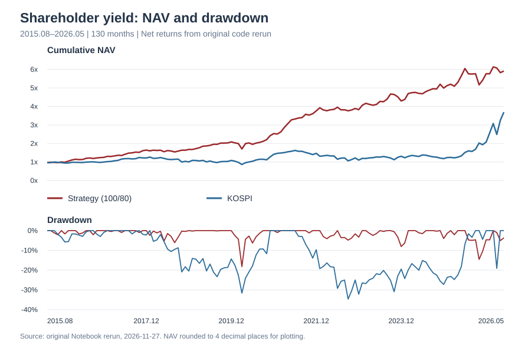
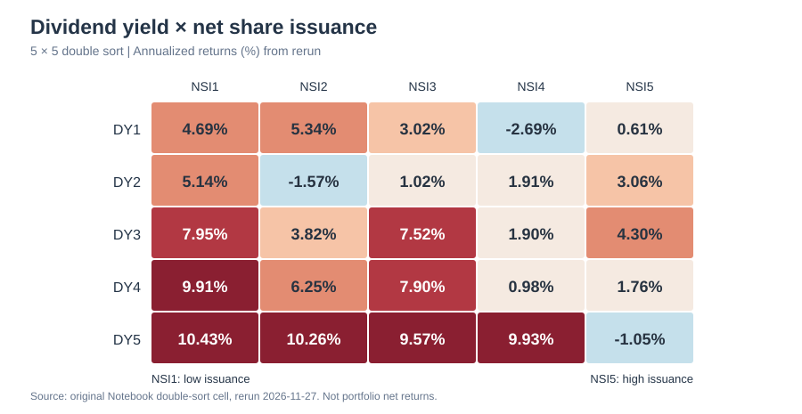
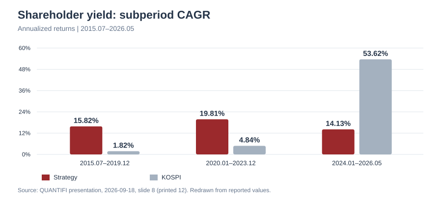

# 02 | Financial Data Quality — Shareholder Yield & Net Share Issuance

> QUANTIFI · 2026 Fall · Team project

> **연구 질문:** 직접 관측하기 어려운 정보를 기존 데이터 간의 관계를 이용해 어떻게 추정할 수 있는가?

[Backtest Notebook](backtest.ipynb) · [데이터 및 방법론](#problem--data-workflow) · [연구 한계](#limitations--reproducibility) · [대표 차트](assets/)

## 연구 질문

1. 단순 발행주식수 변화에는 어떤 기업행동의 영향이 섞이는가?
2. 시가총액과 수정주가를 이용해 수정주식수 대용치를 어떻게 만들 수 있는가?
3. 배당과 주식수 변화의 결합 지표 및 추가 모멘텀 필터가 유효한가?

## 대표 차트

*2026.11.27 제공된 원본 Notebook과 CSV로 기준안(롱 100% / 숏 80%)을 재실행해 얻은 130개월의 NAV와 낙폭입니다. 그림의 월별 NAV는 표시용 소수 넷째 자리 반올림이며 성과표는 원 계산값입니다.*

*원본 Notebook의 5×5 이중정렬 검증 셀 재실행 결과. 원 신호 검증으로 기준안 포트폴리오 자체의 비용 차감 성과와 구분합니다.*

| 수익률 실현 기간: 2015.08–2026.05 | 기준안 | KOSPI (배당 미포함) |
| --- | ---: | ---: |
| CAGR | 17.82% | 12.81% |
| Sharpe (Rf 차감) | 1.154 | 0.537 |
| MDD | -18.20% | -34.64% |
| 연변동성 | 13.06% | 23.22% |

성과표와 차트는 동일한 기준안의 백테스트 결과를 사용한다.

## English summary

A Korean equity shareholder-yield strategy combines dividend yield with the log change of an adjusted-share-count proxy derived from market capitalization and adjusted price. The proxy is intended to reduce mechanical effects of corporate actions and is not a direct measurement of buybacks. The team evaluates CAPM/FF3 alpha, sensitivity and filter ablations.

## 한눈에 보기

| 항목 | 내용 |
| --- | --- |
| 신호 | SY = DY − NSI · 수정주식수 대용치 역산 |
| 운용 | 분기 리밸런싱 · 롱 20 / 숏 20 · 롱100/숏80 |
| 재실행 성과 | CAGR 17.82% · Sharpe 1.154 · MDD -18.20% |
| 통계 검증 | CAPM / FF3 월 알파 1.20% / 0.99% (t=4.04 / 4.04) |
| 한계 | 수정주식수 대용치의 공시 직접 대조 필요 · 공매도 금지 기간 기여 |

대표 성과는 핵심 백테스트 및 요인회귀의 실행 결과입니다.

## Project overview

기업이 성장하더라도 발행주식수가 늘어나면 기존 주주에게 돌아가는 몫은 달라질 수 있다. 이 연구에서는 배당과 주식수 변화라는 서로 다른 정보를 결합해 주주환원을 판단하는 지표를 만들었다. 핵심은 기존 데이터 간의 관계를 활용하여 필요한 정보를 역산한 뒤, 새로운 판단 기준으로 발전시킨 것이다.

## Problem-solving process

1. **문제 정의:** 배당 정보만으로는 주주가 실제로 누리는 지분 변화까지 설명하기 어렵다. 주식수 변화도 함께 고려할 필요가 있었다.
2. **정보 역산:** 시가총액과 주가의 관계에 주목해 시가총액을 원 단위로 변환한 뒤 배당 미반영 수정주가로 나누어 수정주식수의 대용치를 구했다. 기업행동으로 인한 단순 주식수 변동의 영향을 완화하려는 접근이며, 실제 발행주식수나 자사주 소각액을 직접 측정한 값은 아니다.
3. **데이터 정의 확인 및 보완:** 금융업이 빠진 시가총액 자료는 금융업 포함 자료로 보완하고, 신호 계산용 수정주가와 성과 측정용 배당반영 수정주가를 구분했다.
4. **새로운 판단 지표 설계:** 수정주식수 대용치의 기간별 로그 변화율과 배당수익률을 결합해 주주환원 점수를 구성했다.
5. **검증:** 점수에 따른 투자전략을 구현하고 회귀분석, 배당수익률·순주식발행률의 5×5 이중정렬 및 조건별 민감도 분석을 설계했다. 기준안·달러중립안, 기간별 성과 및 이중정렬 결과를 제시했다.

원천 데이터에 원하는 변수가 그대로 존재하지 않더라도, 변수 간 관계와 데이터의 정의를 이해하면 분석 목적에 맞는 대용치와 판단 지표를 구성할 수 있음을 경험한 프로젝트다.

## Problem & data workflow

배당 및 발행주식수 변화를 결합해 주주환원과 지분 희석을 정량화했다. 금융 데이터의 정의 차이, 기업행동에 따른 왜곡, 금융업 데이터 누락을 처리하는 과정이 핵심이다.

| 데이터 | 유형 | 출처 / 입력 파일 | 처리 |
|---|---|---|---|
| DPS | 재무·배당 | FnGuide DataGuide / KOSPIKOSDAQ_DPS.csv | 15개월 lag, 배당 지속성 확인 |
| 수정주가 | 시장 | DataGuide / KOSPIKOSDAQ_수정주가.csv | 월말 가격, 수정주식수 역산 |
| 배당반영 수정주가 | 시장·총수익 | DataGuide / KOSPIKOSDAQ_수정주가(현금배당).csv | 월 총수익률 |
| 시가총액 | 시장 | DataGuide / 시가총액.csv, 시가총액_금융포함.csv | 금융업 포함 파일 우선, 기존 파일로 결측 보완 |
| 거래대금 | 시장·유동성 | DataGuide / 거래대금_금융포함.csv | 중복 열 제거, 월별 정렬 및 rolling |
| KOSPI200 구성 여부 | 시점별 유니버스 | DataGuide / KOSPI200_YN.csv | Y/N→boolean, 월별 숏 후보 |
| KOSPI, SMB, HML, Rf | 요인 데이터 | factor_model_index_0826.csv | 지수 변화율 및 Rf 월환산 |

Notebook은 위 파일들을 DataGuide 와이드 패널로 설명한다. 요인 데이터도 FnGuide DataGuide에서 추출했다. 지수 산출 정의는 별도 확인 대상이다.

## Data engineering & bias control

- 금융업이 빠진 시총 파일을 금융업 포함 파일과 combine_first로 결합했다. 종목 열 교집합, 날짜 정렬, 월말 resampling으로 서로 다른 패널을 일치시켰다.
- 배당 미반영 수정주가는 신호 계산, 현금배당 반영 수정주가는 총수익률 측정에 사용해 입력 데이터의 목적을 구분했다.
- 수정주식수 대용치 = 시가총액(백만원) × 10^6 / 수정주가. 액면분할·무상증자 등 기계적 주식수 변화로 인한 왜곡을 완화하려는 설계다. 공시와 직접 대조한 완전한 소각 측정은 아니다.
- **DPS 15개월 lag:** 회계연도 종료와 배당 확정·공시 사이의 시차를 고려한 보수적 가정. 기업별 실제 공시일을 검증한 것은 아니다.
- NSI는 한 달 전부터 13개월 전까지의 수정주식수 로그 변화율. 시차 적용 전 절댓값 0.30 초과는 결측 처리한다.
- 롱: 시총 상위 30%, 최근 DPS 양수 및 3년 비감소 조건(허용오차 0.1%), DY와 NSI 유효값. 숏: 유효 종목 중 시점별 KOSPI200 구성 종목 및 NSI 유효값. 숏 풀에는 시총 상위 30%가 직접 적용되지 않는다.
- 유동성: 월별 거래대금의 6개월 rolling 평균을 이용하며 시총 상위 30% 내 하위 10%를 기준으로 필터링한다. 원본 코드에서는 ADV 결측도 통과한다. 금융업은 각 레그 최대 6종목(기업명 정규표현식 분류)으로 제한한다.
- 유효 종목 및 시총 분위는 매월 갱신한다. 원천 데이터는 상장기업과 상장폐지 기업을 모두 포함하도록 추출했다. 상폐 수익률 및 결측 수익률 처리(pct_change 기본 동작 포함)는 추가 점검 대상이다.

## Feature engineering

### 수정주식수 대용치 점검 — 삼성전자 액면분할

삼성전자 점검 결과, 2018년 5월 50:1 액면분할을 지나면서 수정주식수 대용치가 급증하지 않는 사례를 확인했다.

| 시점 | 수정주식수 (억주) | 전기 대비 |
| --- | ---: | ---: |
| 2017-06 | 65.33 | — |
| 2018-06 | 64.19 | -1.7% |
| 2018-12 | 59.70 | -7.0% |

이 사례는 분할의 기계적 영향을 완화하려는 설계를 설명한다. 개별 기업행동 및 실제 소각량과의 직접 대조를 완료한 것은 아니다.

$$NSI_{i,t}=\ln(N_{i,t-1}/N_{i,t-13})$$
$$SY_{i,t}=DY_{i,t}-NSI_{i,t}$$

롱 SY 상위 20개, 숏 NSI 상위 20개(KOSPI200), 24개월 역변동성 가중, 분기 리밸런싱, 기준안 롱100/숏80(명목). 왕복 50bp, 대차 연 3%를 월별 적용. 공매도 금지 대응 기본 설정은 BAN_MODE=A(금지 중 리밸런싱 시 신규 숏 선정 안 함)이다. 실제 코드에서 숏 차단은 리밸런싱 분기 내부에 있으므로 금지 시작월 즉시 청산을 보장하지 않는다.

## Statistical validation

KOSPI·SMB·HML 월말 지수의 변화율과 월환산 Rf(연 % /100/12)를 계산하고 수익률 실현 월에 정렬했다. OLS 계수, 잔차, Bartlett 가중 Newey–West HAC(12) 공분산 행렬을 NumPy로 직접 구현하고 scipy.stats.t로 양측 p-value를 계산하는 코드다.

| Model | 월 알파 | t-stat | p-value | N |
|---|---:|---:|---:|---:|
| CAPM | 1.2037% | 4.0365 | 0.00009283 | 130 |
| FF3 | 0.9919% | 4.0439 | 0.00009097 | 130 |

재실행 기준 CAPM 시장 베타 0.0547, R² 0.00937. FF3 MKT 0.1216, SMB 0.2400, HML 0.4417(t=4.8664), R² 0.28003. HML 노출도 유의하게 양수였다. 표본 내 결과이며 인과적 효과나 미래 성과를 보장하지 않는다.

## Reported results | 원본 코드 재실행

| 성과 (2015.08–2026.05) | 기준안 (100/80) | 달러중립안 (100/100) | KOSPI |
|---|---:|---:|---:|
| CAGR | 17.82% | 18.33% | 12.81% |
| Sharpe (Rf 차감) | 1.154 | 1.092 | 0.537 |
| MDD | -18.20% | -18.26% | -34.64% |
| 연변동성 | 13.06% | 14.36% | 23.22% |

| 기간 | 기준안 CAGR | KOSPI CAGR |
|---|---:|---:|
| 2015.07–2019.12 | 18.10% | 1.82% |
| 2020.01–2023.12 | 19.81% | 4.84% |
| 2024.01–2026.05 | 14.13% | 53.62% |

수익률 실현 기준 130개월, 시총·유효성 기준 유니버스 평균 678종목, 롱 후보 평균 275종목, 숏 후보 평균 189종목. 기준안 회전율 연 230%. 코드는 종목 수·숏 비중·금융업 한도·거래비용·가중·리밸런싱 주기·비희석 조건 및 신호별 비교도 포함한다. 이 페이지는 핵심 기준안과 달러중립안, 국면별 성과 및 이중정렬 결과를 제시한다.

## Contribution & tools

팀 연구의 금융 데이터 해석, 전처리, 팩터 구현 및 실증분석에 참여. pandas, NumPy, SciPy, Matplotlib 및 AI 보조 코딩 활용.

## Reproducibility

핵심 분석 실행 환경: Python 3.13 / pandas 2.2.3. 실행 시 코드의 줄바꿈 형식을 확인하고 배당반영 수정주가와 요인 파일을 코드의 입력 경로에 맞춰 준비해야 한다. 원천 금융 데이터는 공개하지 않는다.

## Notebook

[backtest.ipynb](backtest.ipynb) — 전략 구현 및 검증 코드. 원천 데이터 노출 방지를 위해 실행 출력은 제거했으며, 주요 성과와 그래프는 README에 제공한다.

## What we learned | 시행착오와 해석

금융업이 빠진 시가총액 입력을 별도 자료로 보완했으며, 신호 계산용과 총수익률 측정용 가격을 분리했다. 원본 코드의 DY×NSI 검증은 두 변수의 결합 효과를 살펴보는 분석이다. 이 Notebook에는 모멘텀 신호 비교가 구현되어 있지 않아 이를 대표 검증으로 설명하지 않는다.

## Repository structure & execution

| 경로 | 역할 |
| --- | --- |
| [README.md](README.md) | 연구 질문, 방법론, 검증 결과와 한계 |
| [backtest.ipynb](backtest.ipynb) | 기존 계산 로직과 설명 셀을 포함한 Notebook |
| [assets/](assets/) | 원본 코드 재실행 기반 NAV·낙폭·이중정렬·국면별 차트 |

Jupyter Notebook/VS Code에서 Notebook을 열고 상단의 import 및 입력 경로를 확인한다. 위 데이터 출처 표에 명시된 원천 파일을 이용 권한에 맞게 로컬에 준비해야 한다. 저장소만으로는 완전한 실행을 보장하지 않으며 라이브러리 버전 및 실제 실행 환경은 추가 확인이 필요하다.

## Limitations & reproducibility

수정주식수는 대용치이며 실제 자사주 소각액과 동일하지 않다. DPS 15개월 lag의 실제 공시일, ADV 결측 통과, 배당반영 수정주가의 pct_change 기본 결측 처리, 공매도 금지 기간 진입 시 숏 포지션 즉시 청산 여부를 추가 검증해야 한다.

원본 데이터와 내부 발표·보고서는 포함하지 않는다. 보고 성과는 역사적 백테스트이며 실제 운용 결과가 아니다. [전체 포트폴리오로 돌아가기](../).
