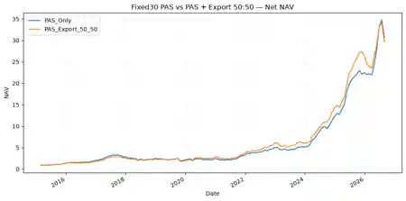
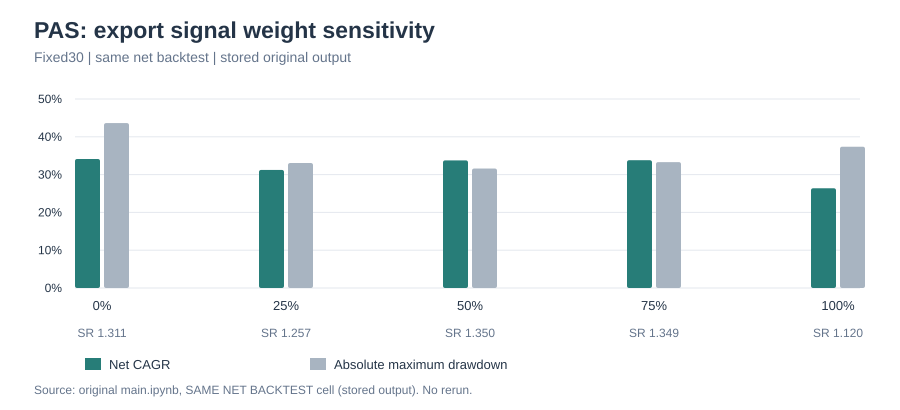

# 03 | Alternative Data Integration — PAS + Export Shock

> QUANTIFI · 2026 Fall · Exploratory team project (최종 채택되지 않음)

> **연구 질문:** 새로운 데이터를 추가하면 기존 의사결정 모델의 성능이 실제로 개선되는가?

[Backtest Notebook](backtest.ipynb) · [데이터 및 방법론](#problem--data-workflow) · [연구 한계](#limitations--reproducibility)

## 연구 질문

1. 기업별 수출액과 산업분류를 일관된 기준으로 연결할 수 있는가?
2. 기업별 구축안의 적합성이 부족할 때 어떤 대체 데이터가 가능한가?
3. 산업별 수출 신호의 추가가 가격 신호만 사용한 경우보다 유효한가?

## 대표 차트

*원본 `main.ipynb`의 Fixed30 백테스트 셀에 저장된 누적수익률 그림을 축소한 이미지입니다. 동일한 Notebook 저장 출력의 성과표를 아래와 같이 정리했습니다.*

| 140개 보유월 | PAS Only | PAS + Export 50:50 |
| --- | ---: | ---: |
| Net CAGR | 34.13% | 33.76% |
| Sharpe (Rf 차감 전) | 1.3113 | 1.3504 |
| MDD | -43.63% | -31.60% |
| 연변동성 | 25.04% | 23.88% |

성과표와 그래프는 Notebook에 저장된 Fixed30 50:50 본 실험의 실행 결과다.

## English summary

An exploratory Korean equity long/short study compares price-asymmetry signals with a combination of price signals and industry export-growth acceleration. The team explored firm-level export collection before adopting industry-level K-stat data. In the main 50:50 experiment, drawdown and Sharpe improved, but CAGR fell slightly and drawdown remained high. The strategy was not adopted as the final approach.

## 한눈에 보기

| 항목 | 내용 |
| --- | --- |
| 신호 | 가격 MOM/VOL/SKEW + 산업별 Export Shock |
| 운용 | 월별 동일가중 · 롱30/숏30 · 수출 1개월 lag |
| 데이터 적용 | 5개 산업 · 월평균 53.7개 / 302개 (보고 17.5%) |
| 보고 성과 | CAGR 33.76% · Sharpe 1.35 · MDD -31.60% |
| 한계 | 최종 미채택 · 추가 정보의 증분 유의성 미검증 |

대표 성과 및 통계 검정은 Notebook에 저장된 실행 결과입니다.

## Project overview

기존 가격 기반 투자전략을 개선하기 위해 산업별 수출 정보를 추가하면 더 유용한 판단 기준을 만들 수 있는지 검토했다. 팀원들과 수출 데이터 확보 및 가공에 많은 시간을 투자했고, 새로운 정보를 결합한 전략과 기존 전략을 비교했다.

## Problem-solving process

1. **문제 정의:** 가격 데이터만 사용하는 전략의 한계를 보완할 수 있는 추가 정보가 필요한지 검토했다.
2. **데이터 확보 및 가공:** 팀 차원에서 여러 출처의 수출 자료를 탐색하고 기업·산업 데이터와 결합할 수 있는 형태를 검토했다. 출처별 산업분류와 관측주기가 다르다는 점을 고려했다.
3. **비교 실험:** 최종 실험에서는 산업별 수출 증가율의 변화를 기존 가격 신호와 결합하고, 기존 전략과 동일한 비교 틀 안에서 성과를 검증했다.
4. **결과에 따른 판단:** 수출 데이터를 결합했을 때 위험 조정 성과와 최대낙폭은 일부 개선되었지만 연환산 수익률은 소폭 낮아졌고, 최대낙폭의 절대 수준도 여전히 높았다.
5. **대안 탐색:** 해당 전략을 최종 채택하지 않았다. 데이터 추가 자체를 목표로 삼기보다 이미 확보한 데이터에서 더 유용한 특성을 찾고 판단 기준을 재설계하는 접근을 후속 [가격 기반 전략 연구](../00-final-strategy-PAS/)에서 탐구했다.

새로운 정보가 항상 더 나은 해결책을 의미하는 것은 아니며, 기존 접근 방식에 투입한 노력보다 실증 결과와 분석 목적을 기준으로 판단하는 것이 중요하다는 점을 배운 연구다. 후속 연구는 다른 전략 조건을 사용하므로 두 프로젝트의 보고 수치를 직접적인 개선 효과로 해석하지 않는다.

## Problem & data workflow

금융시장 데이터와 산업별 실물 정보를 연결하여 가격 신호만 사용했을 때와 비교했다. 핵심은 서로 다른 출처·빈도·산업 분류의 데이터를 연결하고 추가 정보의 유효성을 검증하는 것이다.

### Data provenance

| 데이터 | 유형 | 출처 / 입력 파일 | 처리 |
|---|---|---|---|
| 수정주가·배당반영 수정주가 | 비재무 시장 | FnGuide DataGuide / adj_close_0906.csv, adj_close_dividend_0906.csv | 숫자형 변환, 일·월 데이터 분리 |
| 시총·ADV20 | 시장·유동성 | DataGuide / mkt_cap_0906.csv, 20일평균거래대금.csv | 과거 관측값 정렬, 거래대금 쉼표 제거 |
| 기업 산업분류 | 기업 메타데이터 | DataGuide / Industry27.csv | 기업-산업 연결, 월말 정렬 |
| 품목별 수출 YoY | 대체·실물경제 | 한국무역협회 K-stat (발표 초안) / export_monthly.csv | 산업별 증가율의 변화, 1개월 lag |
| DART 공시 데이터 | 공시·기업 정보 | 금융감독원 DART | 팀 연구에서 기업별 수출액 수집을 탐색; 최종 CSV와의 연결은 미확인 |
| KOSPI, Rf, SMB, HML, Mom | 요인·시장 | FnGuide DataGuide / Factor_0917.csv | 월별 수익률 및 무위험수익률 변환 |

K-stat은 산업·품목별 수출 통계 출처로 발표 초안에 명시된다. DART와 통계청 자료는 아래의 탐색적 데이터 구축 과정에서도 활용되었다. 현재 확인한 Notebook은 CSV 입력 이후 단계부터 시작하므로 수집 과정과 분석용 CSV의 생성 경로를 구분한다.

## Exploratory data acquisition & quality validation

### 데이터 구축에서 전략 재검토까지

| 단계 | 시도 및 판단 |
| --- | --- |
| 1. 기업별 데이터 수집 | 팀원들과 DART 사업보고서에서 기업별 수출액 수집을 시도하고, 한국무역협회(K-stat) 통계와 관련 데이터 문의, 통계청 분류 기준, FnGuide 기업별 산업분류를 활용해 연결 방법을 조사 |
| 2. 산업분류 매핑 | 서로 다른 분류 체계의 데이터를 연결. 당시 팀 내부 설명 기준 매핑 성공률 약 90%, 미매핑 약 10% |
| 3. 활용 적합성 검토 | 연결 이후 데이터 적합도 약 60%대에 그쳐 최초 기업별 구축안을 폐기 |
| 4. 대안 구성 | K-stat 품목별 월간 수출을 FnGuide 산업분류에 연결하는 산업별 접근으로 변경 |
| 5. 비교 실험 | 수출 증가율의 변화(Export Shock)를 1개월 지연해 반영하고 기존 가격 신호와 50:50 결합 |
| 6. 연구 방향 변경 | 위험 지표는 일부 개선됐으나 최대낙폭은 여전히 높고 연환산 수익률은 소폭 감소. 최종 채택하지 않고 후속 가격 신호 재설계 연구로 전환 |

> 초기 매핑·적합도 수치는 당시 팀 내부 설명에 따른 근사치다. 정확한 분모, 적합성 판정 기준 및 산출 원자료는 현재 확인되지 않았다. 적합도 60%대를 결측률·오류율로 해석하지 않는다.

**최종 분석에 사용한 산업별 매핑** (팀 투자제안서 3·7·30쪽 기준)

| FnGuide 산업 | K-stat 수출 품목 |
| --- | --- |
| 반도체 | 반도체 |
| 자동차 및 부품 | 자동차 |
| 조선 | 선박 |
| 화학 | 석유화학 |
| 디스플레이 | 디스플레이 |
| 나머지 22개 산업 | 기존 가격 신호 유지 |

월평균 거래 가능 종목 302개 중 53.7개(제안서 보고 기준 17.5%)에 수출 신호를 반영했다. 이는 초기 기업별 매핑 성공률과 다른 지표이며, 나머지 82.5%는 매핑 실패율이 아니라 미적용 비율이다.

현재 Notebook은 분석용 CSV 입력 이후 단계부터 시작하며 원본 수집 코드와 초기 구축안은 게시하지 않는다. 17.5%는 팀 연구에서 보고한 적용 범위다.

## Data engineering & bias control

- 날짜 파싱, 종목 패널 교집합, 거래대금 문자열의 쉼표 제거 및 numeric coercion.
- 실제 월 마지막 거래일 기준으로 일별·월별 가격, 산업 분류, 시가총액을 정렬. 과거 관측값의 forward fill은 시점 일치 목적이며 오래된 가격의 유효성도 점검해야 한다.
- 반도체·자동차·자동차부품·조선·화학·디스플레이의 6개 코드 그룹을 매핑한다(발표에서는 자동차 및 부품을 합쳐 5개 산업). 매핑되지 않은 종목은 기존 가격 신호 유지.
- **수출 1개월 lag:** 월별 통계가 해당 월 종료 이후 발표되는 특성을 고려하여 shock를 한 달 뒤 사용. 실제 발표일·정정 이력 검증은 추가 필요.
- 시총 상위 30%를 매월 갱신하고 당시 가격·팩터 가용성을 고려했다. 원천 데이터 추출 시 상장기업과 상장폐지 기업을 모두 포함했다. 실제 상폐 수익률 커버리지 및 미래 수익률 결측에 의한 선정 편향은 추가 검증 대상이다.

$$ExportShock_{j,t}=YoY_{j,t}-YoY_{j,t-1}$$

12–1개월 MOM, 126거래일 VOL/SKEW(최소 100개 관측)를 횡단면 순위화한다. 원본의 비대칭 가격 신호는 다음과 같다.

$LONG=R(MOM)(1-R(SKEW)),\qquad PAS=R(MOM)(1-R(VOL))(1-R(SKEW))$

두 가격 점수를 다시 순위화한 후 수출 shock의 횡단면 순위와 각각 50:50 결합한다. 미매핑 종목은 가격 점수 그대로 유지. Fixed30 본 실험은 숏 점수 하위 30종목을 먼저 선정하고 이를 제외한 롱 점수 상위 30종목을 선정한다. 월별 동일가중, Gross 200%, Net 0%.

- 거래비용: 회전율에 0.002를 곱하는 방식(편도 20bp, 왕복 40bp에 해당), 대차 연 3%/12.
- 각 레그 AUM 1,000억원, 하루 ADV20의 10%, 5일간 목표 주문액의 80% 기준으로 사전 유동성 필터 적용(ADV20 약 53.33억원/일 이상).
- 원본 실행 출력에서 수출 결합안의 평균 5일 리밸런싱 체결률은 89.67%, 양 레그 모두 80%를 만족한 월의 비율은 87.86%. 모든 달이 제약을 만족하는 것은 아니다. 모델상 예상 체결률이며 실제 체결 기록이 아니다.
- 본 실험에는 공매도 전면 금지 기간을 별도로 제외하는 조건이 없어 실제 운용 가능성과 구분한다.

## Statistical validation & experiment design

main.ipynb의 분위 수익률 차이에 상수항 OLS + HAC(6)를 적용하여 평균 차이의 양측 p-value를 산출했다.

| Test | 월 평균 차이 | HAC t | p-value | N |
|---|---:|---:|---:|---:|
| Composite Q5−Q1 | 2.041% | 4.1005 | 0.00004 | 140 |
| Long Q5−Q1 | 1.563% | 3.3165 | 0.00091 | 140 |
| Short Q1−Q5 (기초자산 수익률 차이) | -2.407% | -3.98238 | 0.00007 | 140 |

숏 신호 하위 그룹의 기초자산 수익률이 상대적으로 낮다는 결과다. 이는 실제 공매도 비용 차감 P&L과 구분된다.

시장 통제 회귀와 Rf 조정 초과수익 검증도 수행했다. Factor_0917.csv의 KOSPI를 이용했으며 KOSPI200 파일이 없는 저장 결과에서는 KOSPI proxy로 표시한다. 50:50의 Rf 조정 평균수익 HAC p-value 0.00029는 FF3 알파 p-value가 아니다.

### 수출 신호 비중 비교 (동일한 순성과 백테스트)

| 수출 비중 | Net CAGR | Sharpe (Rf 차감 전) | MDD |
|---|---:|---:|---:|
| 0% | 34.128% | 1.31135 | -43.626% |
| 25% | 31.232% | 1.25679 | -33.063% |
| 50% | 33.760% | 1.35042 | -31.599% |
| 75% | 33.802% | 1.34918 | -33.302% |
| 100% | 26.380% | 1.12028 | -37.377% |

원본 main.ipynb의 SAME NET BACKTEST(셀 10, 0부터 시작)의 저장값. 별도의 증분 효과 검정 없이 수출 데이터 추가 효과가 통계적으로 유의하다고 주장하지 않는다.

## Reported results

| Main 50:50 experiment | PAS Only | PAS + Export |
|---|---:|---:|
| Net CAGR | 34.13% | 33.76% |
| Sharpe (Rf 차감 전) | 1.3113 | 1.3504 |
| MDD | -43.63% | -31.60% |

수출 데이터 결합 시 낙폭이 줄었으나 절대 수준은 여전히 높았다. 가중치 민감도, 5×5 이중정렬, 기간별 및 체결 가능성 검증을 수행했다. 최종 전략으로 채택되지 않은 연구도 비교 실험의 결과로 보존한다. 수치는 원본 main.ipynb 저장 출력이며 독립 재실행하지 않았다. 저장 출력의 Rf 차감 Sharpe는 PAS Only 1.23041, PAS + Export 1.26528로 별도로 보고된다.

## Contribution

팀원들과 데이터 확보 및 가공을 진행한 공동 연구로, 데이터 결합 이후 분석, 신호 설계, 비교 실험 및 검증에 참여했다. pandas, NumPy, statsmodels, Matplotlib 및 AI 보조 코딩 활용.

## Reproducibility

[backtest.ipynb](backtest.ipynb)는 Fixed30 전략 구현 및 검증 코드다. 전체 실행에는 원천 데이터와 보조 모듈 fixed30_execution_regression.py 및 export_month_selection_audit.py가 필요하며 현재 저장소에는 포함되어 있지 않다.

## What we learned | 시행착오와 해석

초기 기업별 구축안 폐기와 산업별 대체안의 최종 미채택은 서로 다른 판단이다. 대표 결과는 main.ipynb의 Fixed30 본 실험과 동일 조건에서 계산된 수출 비중 민감도로 한정한다.

## Repository structure & execution

| 경로 | 역할 |
| --- | --- |
| [README.md](README.md) | 연구 질문, 방법론, 검증 결과와 한계 |
| [backtest.ipynb](backtest.ipynb) | 기존 계산 로직과 설명 셀을 포함한 Notebook |
| [assets/](assets/) | 원본 저장 그래프, 민감도 차트 및 출처 안내 |

Jupyter Notebook/VS Code에서 Notebook을 열고 상단의 import 및 입력 경로를 확인한다. 위 데이터 출처 표에 명시된 원천 파일을 이용 권한에 맞게 로컬에 준비해야 한다. 저장소만으로는 완전한 실행을 보장하지 않으며 라이브러리 버전 및 실제 실행 환경은 추가 확인이 필요하다.

## Limitations & reproducibility

매핑·적합도 수치는 근사 내부 설명으로 기준 미확인. 수출 통계 실제 발표일·정정 이력, 매핑 범위, 증분 효과, 보조 모듈 및 원천 수집 코드가 추가 확인 대상이다.

원본 데이터와 내부 발표·보고서는 포함하지 않는다. 보고 성과는 역사적 백테스트이며 실제 운용 결과가 아니다. [전체 포트폴리오로 돌아가기](../).
