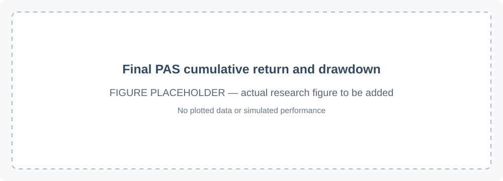

# 04 | Statistical Feature Engineering — Price Asymmetric Strategy (PAS)

> QUANTIFI · 2026 Fall · Final team research

> **연구 질문:** 하나의 가격 시계열에서 네 가지 통계적 특성을 추출하고 목적에 맞는 판단 규칙으로 결합할 수 있는가?

[Backtest Notebook](backtest.ipynb) · [데이터 및 방법론](#problem--data-workflow) · [연구 한계](#limitations--reproducibility) · [그림 교체 안내](assets/README.md)

## 연구 질문

1. 동일한 수익률을 기록한 종목의 가격 경로 차이를 어떤 통계량으로 구별할 수 있는가?
2. 네 통계량을 비교 가능한 순위로 변환하고 롱·숏 규칙에 어떻게 결합할 것인가?
3. 점수의 예측력과 유지 기간, 거래 가능성을 어떤 실험으로 검증할 것인가?

## 대표 차트

*실제 연구 그래프가 확보되면 교체할 자리입니다. 현재 그림은 성과 데이터가 아닙니다.*

## English summary

A price-asymmetry strategy derives momentum, daily return volatility, skewness and a mean-to-standard-deviation Sharpe proxy from adjusted prices. Cross-sectional ranks are combined into distinct long and short scores. Rolling IC, signal decay and execution assumptions are examined. Reported results are distinguished by strategy version.

## 한눈에 보기

| 항목 | 내용 |
| --- | --- |
| 신호 | MOM6 · VOL126 · SKEW126 · SHARPE126 |
| 운용 | 분기 리밸런싱 · 롱110/숏90 · 5일 체결 조건 |
| 설명서 성과 | CAGR 21.6% · Sharpe 1.14 · MDD -13.6% |
| 최종 발표 별도 버전 | CAGR 23.55% · Sharpe 1.24 · MDD -13.5% |
| 한계 | next_date 가격 존재 필터의 미래정보 위험 · 버전 구분 |

성과는 기존 Notebook 저장 결과 또는 팀 보고값이며 독립적으로 재실행하지 않았습니다.

## Project overview

일별 주가는 시간 순서가 있는 데이터다. 단순히 가격이 얼마나 상승했는지뿐 아니라 상승 과정의 변동성, 수익률 분포의 형태, 위험 대비 수익 특성까지 고려하면 서로 다른 가격 움직임을 구별할 수 있지 않을까? 이 연구에서는 하나의 원천 데이터인 일별 수정주가에서 네 가지 통계적 특성을 추출하고, 이를 결합하여 투자 판단 규칙을 설계했다.

## Problem-solving process

*개념 설명용 가상 경로이며 실제 시장 데이터가 아니다.*

### 1. 하나의 시계열에서 네 가지 정보 추출

| 통계적 특성 | 의미 | 활용 관점 |
| --- | --- | --- |
| Momentum (MOM6) | 최근 한 달을 제외한 중기 가격 변화 | 상승·하락 추세의 강도 |
| Skewness (SKEW126) | 최근 126거래일 일간 수익률 분포의 비대칭성 | 수익률이 한쪽으로 치우치는 형태 |
| Sharpe proxy (SHARPE126) | 최근 126거래일 일간 수익률 평균 / 표준편차 | 변동성 대비 수익 특성 |
| Volatility (VOL126) | 최근 126거래일 일간 수익률의 표준편차 | 가격 움직임의 불안정성 |

### 2. 서로 다른 특성을 비교 가능한 기준으로 변환

각 특성을 종목 간 상대적 순위로 변환해 단위와 스케일 차이를 줄였다. 하나의 통계량만으로 종목을 판단하는 대신 서로 다른 관점의 정보를 결합했다.

### 3. 목적에 맞게 판단 규칙 설계

매수 후보와 공매도 후보에 서로 다른 점수식을 적용했다. 매수 점수는 모멘텀·Sharpe 대용 지표·왜도 순위를, 공매도 후보 선정에 사용하는 점수는 모멘텀·변동성·왜도 순위를 결합한다. 상세 수식과 선정 조건은 아래 Model & validation에 정리했다.

### 4. 설계한 규칙의 유효성 검증

- **예측력 분석 (Rolling IC):** 점수와 이후 수익률의 순위 상관관계를 시간에 따라 확인했다.
- **예측 기간별 분석 (Signal Decay):** 예측 기간을 바꾸며 점수와 이후 수익률의 관계를 검토했다.
- **민감도 분석:** 예상 체결기간을 달리한 성과 비교와 스코어 분포 분석을 수행했다.
- **성과 평가:** 거래비용과 유동성 조건을 고려한 백테스트 및 팀 보고서의 요인 회귀 결과를 검토했다.

핵심 투자신호 네 가지는 수정주가에서 도출했지만, 거래 가능성 검토와 성과 측정에는 시가총액, 거래대금, 배당반영 수정주가 및 시장·요인 데이터도 사용했다. 하나의 원천 데이터에서 여러 의미 있는 특성을 도출하고 이를 실제 의사결정에 사용할 규칙으로 구조화한 경험이다.

## Problem & data workflow

가격 추세의 강도뿐 아니라 수익률 분포와 변동성을 활용해 지속적인 상승과 취약한 상승을 구분하는 연구. 재무제표 없이 시계열 시장 데이터를 처리하고 통계적 피처를 설계했다.

| 데이터 | 유형 | 출처 / 입력 파일 | 처리 |
|---|---|---|---|
| 일별 수정주가 | 비재무 시장 | FnGuide DataGuide / adj_close_0906.csv | 일간 수익률, 월말 모멘텀, rolling 통계 |
| 배당반영 수정주가 | 시장·총수익 | DataGuide / adj_close_dividend_0906.csv | 월별 총수익률 |
| 월말 시가총액 | 시장 | DataGuide / mkt_cap_0906.csv | 시점별 상위 30% |
| 일별 ADV20 | 시장·유동성 | DataGuide / 20일평균거래대금.csv | 예상 체결 가능성 |
| KOSPI, Rf, SMB, HML, Mom | 시장·요인 | Factor_0917.csv | 벤치마크, Rf 조정, 보고서의 Carhart 회귀 |

주요 데이터는 팀 DataGuide 추출 자료. 요인 데이터(KOSPI, SMB, HML, MOM, Rf)도 FnGuide DataGuide에서 추출했다. 지수 산출 정의는 별도 확인 대상이다.

## Data engineering & bias control

- 날짜 파싱, numeric coercion, 종목 교집합, 실제 마지막 거래일을 기준으로 일·월 패널 정렬.
- 신호용 수정주가와 성과 측정용 배당반영 수정주가를 구분.
- MOM6 = P(t−1)/P(t−6)−1. 최근 한 달을 제외한 모멘텀, MOM12는 최소 가격 이력 확인에 사용.
- 일간 수익률에서 126일 rolling mean·std·skew(최소 100개 관측)를 계산하고, 평균/표준편차로 종목의 Sharpe 대용 지표 생성.
- 재무제표 공시 시차를 쓰는 전략이 아니므로 일률적인 3개월 lag를 적용하지 않는다. 형성일과 보유기간을 분리하고 과거 관측값으로 시총·거래대금을 정렬한다.
- 유니버스를 시점별로 구성하며 상폐 기업을 포함하는 원천 자료 사용은 생존편향 완화를 위한 팀의 데이터 수집 원칙이다. 팀의 확인에 따르면 네 프로젝트 모두 상장기업과 상장폐지 기업을 포함해 추출했다. 상폐 수익률 커버리지는 아직 독립 확인하지 않았다.
- **추가 점검:** 실제 코드의 pick()에는 next_date 가격 존재 여부를 확인하는 필터가 있다. 이는 미래 데이터 가용성을 이용할 수 있어 look-ahead 위험이 있으며, forward fill된 가격의 상폐 처리 및 비중 재정규화 후 체결률도 재검토해야 한다. 원본 계산 로직은 임의 수정하지 않는다.

## Model & validation

$$L=R(MOM6)R(SHARPE126)(1-R(SKEW126))$$
$$S=R(MOM6)(1-R(VOL126))(1-R(SKEW126))$$

숏 하위 100개 우선, 롱 상위 50개 후보 및 하락일 60일 이상 조건. ADV20 10%, 5일간 목표수량의 80% 체결 조건. 롱110/숏90, 분기 리밸런싱, 왕복 50bp 및 연 3% 대차.

제출 Notebook에는 체결기간별 성과 비교, Rolling IC 및 Signal Decay, 스코어 분포 분석이 있다. 단기 수익률과 점수의 Spearman 상관 및 예측 기간별 관계를 확인하는 실험이다.

### Factor regression (팀 전략설명서)

보고서의 Carhart 4요인 모델은 KOSPI 월수익률−Rf, SMB·HML·MOM 지수의 월 변화율과 전략 월 초과수익률을 정렬하고 HAC(12)로 표준오차를 보정했다.

| Variable | Coefficient | t-stat | p-value |
|---|---:|---:|---:|
| Alpha (월) | 0.0127 | 3.30 | <0.001 |
| MKT−RF | 0.0324 | 0.43 | 0.664 |
| SMB | -0.2148 | -1.39 | 0.165 |
| HML | 0.1413 | 0.96 | 0.338 |
| MOM | 0.0818 | 0.72 | 0.473 |

N=120, R²=0.106. 시장·규모·가치·모멘텀 통제 후 양의 절편이 보고되었고 시장 베타는 통계적으로 유의하지 않았다. 낮은 R²는 설명되지 않는 변동 비율이 크다는 뜻이지 그 전체가 알파라는 뜻이 아니다. 회귀 구현 셀은 현재 제출 Notebook에 포함되지 않아 보고서 수치로 구분한다.

| 5-day execution (report) | Strategy | KOSPI200 |
|---|---:|---:|
| CAGR | 21.6% | 15.4% |
| Sharpe (Rf adjusted) | 1.14 | 0.57 |
| MDD | -13.6% | -35.9% |

2016.09–2026.08 제출 코드와 연결된 설명서 기준. 최종 발표의 별도 버전은 CAGR 23.55%, Sharpe 1.24, MDD -13.5%를 보고한다. 두 버전을 혼합하지 않는다. 공매도 금지기간의 실행 가능성 및 비용 정합성은 한계다. 독립 재실행 결과가 아니다.

## Contribution & tools

팀 연구의 피처 설계, Python 구현, 데이터 처리, 백테스트 및 성과·리스크 분석에 참여. pandas, NumPy, Matplotlib, Jupyter 및 AI 보조 코딩 활용. 원천 데이터 및 내부 보고서는 게시하지 않는다.

## Notebook

[backtest.ipynb](backtest.ipynb) — 기존 계산 로직을 유지하고 설명 셀을 추가한 버전. 저장된 실행 출력은 제거했으며 독립 재실행은 수행하지 않았다.

## What we learned | 시행착오와 해석

평가에는 Rolling IC, Signal Decay, 체결기간 비교 및 스코어 분포가 포함된다. 보고서의 Carhart 회귀는 제출 Notebook에서 재현된 결과와 구분한다.

## Repository structure & execution

| 경로 | 역할 |
| --- | --- |
| [README.md](README.md) | 연구 질문, 방법론, 검증 결과와 한계 |
| [backtest.ipynb](backtest.ipynb) | 기존 계산 로직과 설명 셀을 포함한 Notebook |
| [assets/](assets/) | 대표 그림 배치 및 교체 안내 |

Jupyter Notebook/VS Code에서 Notebook을 열고 상단의 import 및 입력 경로를 확인한다. 위 데이터 출처 표에 명시된 원천 파일을 이용 권한에 맞게 로컬에 준비해야 한다. 저장소만으로는 완전한 실행을 보장하지 않으며 라이브러리 버전 및 실제 실행 환경은 추가 확인이 필요하다.

## Limitations & reproducibility

pick()의 다음 날짜 가격 가용성 확인, forward fill·상폐 처리 및 비중 재정규화 후 체결률은 추가 검증 대상이다. 두 보고 성과 버전을 혼합하지 않는다.

원본 데이터와 내부 발표·보고서는 포함하지 않는다. 보고 성과는 역사적 백테스트이며 실제 운용 결과가 아니다. [전체 포트폴리오로 돌아가기](../).
