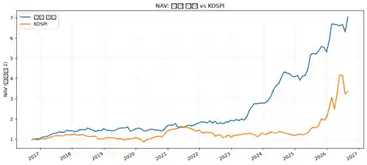
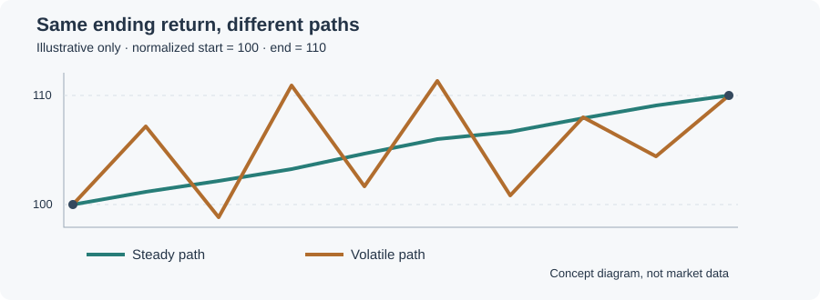
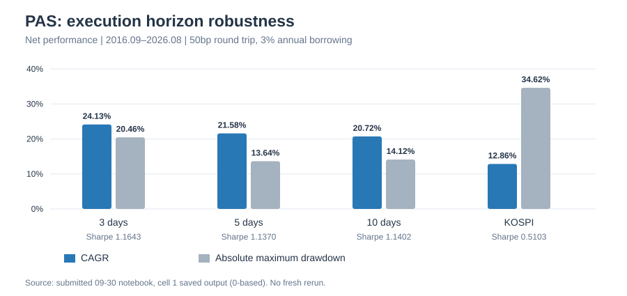
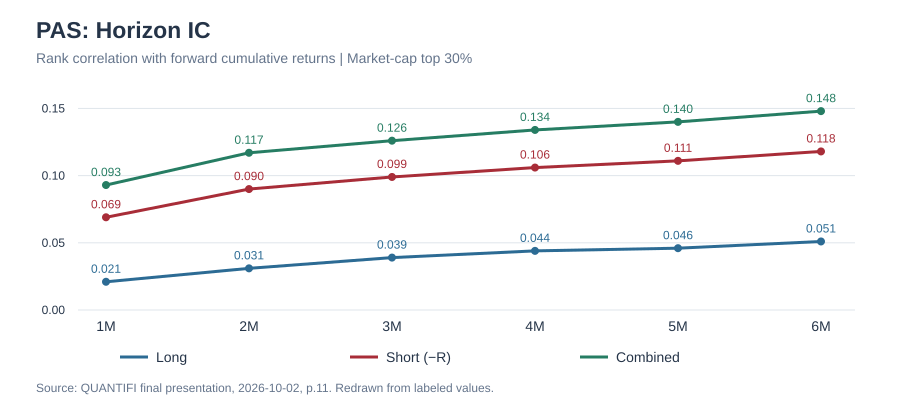

# 04 | Statistical Feature Engineering — Price Asymmetric Strategy (PAS)

> QUANTIFI · 2026 Fall · Final team research

> **연구 질문:** 하나의 가격 시계열에서 네 가지 통계적 특성을 추출하고 목적에 맞는 판단 규칙으로 결합할 수 있는가?

[Backtest Notebook](backtest.ipynb) · [데이터 및 방법론](#problem--data-workflow) · [연구 한계](#limitations--reproducibility) · [대표 차트](assets/)

## 연구 질문

1. 동일한 수익률을 기록한 종목의 가격 경로 차이를 어떤 통계량으로 구별할 수 있는가?
2. 네 통계량을 비교 가능한 순위로 변환하고 롱·숏 규칙에 어떻게 결합할 것인가?
3. 점수의 예측력과 유지 기간, 거래 가능성을 어떤 실험으로 검증할 것인가?

## 대표 차트

*원본 `1팀코드제출_0930(2).ipynb` 첫 코드 셀의 저장 그래프를 축소한 이미지. 파란색은 롱숏 전략, 주황색은 KOSPI이다. 원본의 한글 글꼴 깨짐은 유지되며, 실제 가격 데이터를 다시 계산한 그림은 아니다.*

| 2016.09–2026.08 · 120개월 | 5일 체결 가정 | KOSPI |
| --- | ---: | ---: |
| CAGR | 21.58% | 12.86% |
| Sharpe (Rf 반영) | 1.1370 | 0.5103 |
| MDD | -13.64% | -34.62% |
| 연변동성 | 16.71% | 26.28% |

성과는 Notebook의 5일 체결 가정 실행 결과(`result_rf.round(4)`)를 기준으로 한다.

## English summary

A price-asymmetry strategy derives momentum, daily return volatility, skewness and a mean-to-standard-deviation Sharpe proxy from adjusted prices. Cross-sectional ranks are combined into distinct long and short scores. Rolling IC, signal decay and execution assumptions are examined. The results and charts are based on the notebook's saved outputs; the benchmark is KOSPI.

## 한눈에 보기

| 항목 | 내용 |
| --- | --- |
| 신호 | MOM6 · VOL126 · SKEW126 · SHARPE126 |
| 운용 | 분기 리밸런싱 · 롱 후보 50 / 숏 후보 100 · 롱110%/숏90% · 5일 체결 가정 |
| Notebook 저장 성과 | CAGR 21.58% · Sharpe 1.1370 · MDD -13.64% |
| 비교 지수 | KOSPI |
| 한계 | next_date 가격 존재 필터의 미래정보 위험 · 실제 체결 및 공매도 금지 미반영 |

대표 성과는 Notebook에 저장된 백테스트 결과입니다.

## Project overview

일별 주가는 시간 순서가 있는 데이터다. 단순히 가격이 얼마나 상승했는지뿐 아니라 상승 과정의 변동성, 수익률 분포의 형태, 위험 대비 수익 특성까지 고려하면 서로 다른 가격 움직임을 구별할 수 있지 않을까? 이 연구에서는 하나의 원천 데이터인 일별 수정주가에서 네 가지 통계적 특성을 추출하고, 이를 결합하여 투자 판단 규칙을 설계했다.

## Problem-solving process

*개념 설명용 가상 경로이며 실제 시장 데이터가 아니다.*

### 1. 하나의 시계열에서 네 가지 정보 추출

| 통계적 특성 | 의미 | 활용 관점 |
| --- | --- | --- |
| Momentum (MOM6) | 최근 한 달을 제외한 중기 가격 변화 | 상승·하락 추세의 강도 |
| Skewness (SKEW126) | 최근 126거래일 일간 수익률 분포의 비대칭성 | 수익률이 한쪽으로 치우치는 형태 |
| Sharpe proxy (SHARPE126) | 최근 126거래일 일간 수익률 평균 / 표준편차 | 변동성 대비 수익 특성 |
| Volatility (VOL126) | 최근 126거래일 일간 수익률의 표준편차 | 가격 움직임의 불안정성 |

### 2. 서로 다른 특성을 비교 가능한 기준으로 변환

각 특성을 종목 간 상대적 순위로 변환해 단위와 스케일 차이를 줄였다. 하나의 통계량만으로 종목을 판단하는 대신 서로 다른 관점의 정보를 결합했다.

### 3. 목적에 맞게 판단 규칙 설계

매수 후보와 공매도 후보에 서로 다른 점수식을 적용했다. 매수 점수는 모멘텀·Sharpe 대용 지표·왜도 순위를, 공매도 후보 선정에 사용하는 점수는 모멘텀·변동성·왜도 순위를 결합한다. 상세 수식과 선정 조건은 아래 Model & validation에 정리했다.

### 4. 설계한 규칙의 유효성 검증

- **예측력 분석 (Rolling IC):** 점수와 이후 수익률의 순위 상관관계를 시간에 따라 확인했다.
- **예측 기간별 분석 (Signal Decay):** 예측 기간을 바꾸며 점수와 이후 수익률의 관계를 검토했다.
- **민감도 분석:** 예상 체결기간을 달리한 성과 비교와 스코어 분포 분석을 수행했다.
- **성과 평가:** 거래비용과 유동성 조건을 고려한 백테스트를 실행하고 KOSPI와 비교했다.

핵심 투자신호 네 가지는 수정주가에서 도출했지만, 거래 가능성 검토와 성과 측정에는 시가총액, 거래대금, 배당반영 수정주가 및 시장·요인 데이터도 사용했다. 하나의 원천 데이터에서 여러 의미 있는 특성을 도출하고 이를 실제 의사결정에 사용할 규칙으로 구조화한 경험이다.

## Problem & data workflow

가격 추세의 강도뿐 아니라 수익률 분포와 변동성을 활용해 지속적인 상승과 취약한 상승을 구분하는 연구. 재무제표 없이 시계열 시장 데이터를 처리하고 통계적 피처를 설계했다.

| 데이터 | 유형 | 출처 / 입력 파일 | 처리 |
|---|---|---|---|
| 일별 수정주가 | 비재무 시장 | FnGuide DataGuide / adj_close_0906.csv | 일간 수익률, 월말 모멘텀, rolling 통계 |
| 배당반영 수정주가 | 시장·총수익 | DataGuide / adj_close_dividend_0906.csv | 월별 총수익률 |
| 월말 시가총액 | 시장 | DataGuide / mkt_cap_0906.csv | 시점별 상위 30% |
| 일별 ADV20 | 시장·유동성 | DataGuide / 20일평균거래대금.csv | 예상 체결 가능성 |
| KOSPI, Rf | 시장·요인 | Factor_0917.csv | KOSPI 벤치마크 및 무위험수익률 환산 |

주요 데이터는 팀 DataGuide 추출 자료. 원본 Notebook은 요인 파일 중 KOSPI와 Rf를 실제로 사용한다. 지수 산출 정의는 별도 확인 대상이다.

## Data engineering & bias control

- 날짜 파싱, numeric coercion, 종목 교집합, 실제 마지막 거래일을 기준으로 일·월 패널 정렬.
- 신호용 수정주가와 성과 측정용 배당반영 수정주가를 구분.
- MOM6 = P(t−1)/P(t−6)−1. 최근 한 달을 제외한 모멘텀, MOM12는 최소 가격 이력 확인에 사용.
- 일간 수익률에서 126일 rolling mean·std·skew(최소 100개 관측)를 계산하고, 평균/표준편차로 종목의 Sharpe 대용 지표 생성.
- 재무제표 공시 시차를 쓰는 전략이 아니므로 일률적인 3개월 lag를 적용하지 않는다. 형성일과 보유기간을 분리하고 과거 관측값으로 시총·거래대금을 정렬한다.
- 유니버스를 시점별로 구성하며 상폐 기업을 포함하는 원천 자료 사용은 생존편향 완화를 위한 팀의 데이터 수집 원칙이다. 팀의 확인에 따르면 네 프로젝트 모두 상장기업과 상장폐지 기업을 포함해 추출했다. 상폐 수익률 커버리지는 아직 독립 확인하지 않았다.
- **추가 점검:** 실제 코드의 pick()에는 next_date 가격 존재 여부를 확인하는 필터가 있다. 이는 미래 데이터 가용성을 이용할 수 있어 look-ahead 위험이 있으며, forward fill된 가격의 상폐 처리 및 비중 재정규화 후 체결률도 재검토해야 한다. 원본 계산 로직은 임의 수정하지 않는다.

## Model & validation

$$L=R(MOM6)R(SHARPE126)(1-R(SKEW126))$$
$$S=R(MOM6)(1-R(VOL126))(1-R(SKEW126))$$

### 종목 선정 및 운용 조건

- 형성일 시가총액 상위 30%와 MOM12·MOM6·VOL·SKEW·평균수익률 유효 조건을 적용한다. MOM12는 점수에 직접 사용하지 않는 가격 이력 조건이다.
- 숏 점수 하위 100개를 우선 선정하고, 이를 제외한 롱 적격 종목(Sharpe 대용치 유효, 최근 126거래일 중 하락 수익률 관측 60일 이상)에서 롱 점수 상위 50개를 선정한다.
- 레그별 가정 운용금액 1,000억원을 목표 종목 수로 나눈 주문금액은 롱 20억원, 숏 10억원이다. 하루 ADV20의 10%까지 체결 가능하다고 가정하고, 5일 기준 예상 체결률 80% 이상인 후보만 편입한다(ADV20 하한 롱 32억원, 숏 16억원). 탈락한 자리는 보충하지 않는다.
- 편입 후 레그별 동일가중, 명목 롱 110%·숏 90%(Gross 200%, Net +20%). 110과 90은 종목 수가 아니라 노출 비중이다. 2016년 8월 말부터 3개월마다 종목을 재선정하며, 분기 내에는 편입 종목의 월별 단순평균 수익률을 사용한다.
- 매매비용은 편도 25bp × 노출 가중 회전율(왕복 50bp 상당), 대차비용은 숏 노출 90%에 연 3%를 월할해 차감한다(월 0.225%).

### 1. 체결 기간 민감도

| 지표 | 3일 | 5일 (기준) | 10일 | KOSPI |
| --- | ---: | ---: | ---: | ---: |
| CAGR | 24.13% | 21.58% | 20.72% | 12.86% |
| 연변동성 | 18.39% | 16.71% | 15.93% | 26.28% |
| Sharpe (Rf 반영) | 1.1643 | 1.1370 | 1.1402 | 0.5103 |
| MDD | -20.46% | -13.64% | -14.12% | -34.62% |

3일 가정은 수익률이 높지만 최대낙폭도 크고, 5일 가정은 세 전략 중 최대낙폭이 가장 작다. 위 결과는 체결기간 가정에 대한 민감도이지 실제 체결 기록이 아니다. Rf는 연율(%)을 252거래일 기준 일수익률로 환산하고 월별 복리 누적한다. Sharpe 분자는 월 초과수익률 평균, 분모는 전략 월수익률의 표준편차이다.

### 2. Horizon IC / Signal Decay

| 예측 기간 (누적수익률) | Long IC | Short IC | Long 양수 비율 | Short 양수 비율 | 관측 월 |
| --- | ---: | ---: | ---: | ---: | ---: |
| 1개월 | 0.0080 | 0.0945 | 55.00% | 76.67% | 120 |
| 2개월 | 0.0149 | 0.1226 | 57.98% | 81.51% | 119 |
| 3개월 | 0.0189 | 0.1334 | 62.71% | 84.75% | 118 |

각 월 형성 시점의 원점수와 이후 1~3개월 **누적** 수익률의 횡단면 Spearman 상관계수를 계산한다. IC용 get_scores()는 미래 가격 존재 여부, 유동성 필터, 상·하위 후보 선정을 사용하지 않는다. 롱 IC에는 하락일 조건을 적용한다. 숏 점수는 낮은 종목을 공매도하므로 **원점수와 기초자산 수익률의 양의 상관**이 전략 방향과 일치한다. 원본에는 12개월 Rolling IC(최소 6개월) 그래프와 3M/1M IC 비율도 저장되어 있다(롱 235.38%, 숏 141.17%). 롱의 절대 IC는 작으며 작은 분모에 따른 비율 확대 및 누적수익률 구간 중첩을 고려해야 한다. 별도의 유의성 검정이나 최적 리밸런싱 주기의 입증은 아니다.

### 3. 점수 분포 및 선정 단계 점검

마지막 리밸런싱 형성일 2026.05.29의 원본 저장 출력:

| 구분 | 유효 점수 수 | 점수 후보 | 유동성 통과 후 편입 | 점수 중앙값 |
| --- | ---: | ---: | ---: | ---: |
| Long | 960 | 50 | 47 | 0.0826 |
| Short | 964 | 100 | 88 | 0.0699 |

점수의 원값·백분위 순위 및 필터 전후 후보를 시각화하는 셀이 포함되어 있다. 이는 마지막 형성일 사례이며 전체 기간 평균 체결률이 아니다.

## Contribution & tools

팀 연구의 피처 설계, Python 구현, 데이터 처리, 백테스트 및 성과·리스크 분석에 참여. pandas, NumPy, Matplotlib, Jupyter 및 AI 보조 코딩 활용. 원천 데이터 및 내부 보고서는 게시하지 않는다.

## Notebook

[backtest.ipynb](backtest.ipynb) — 전략 구현 및 검증 코드. 원천 데이터 노출 방지를 위해 실행 출력은 제거했으며, 주요 결과는 README에 제공한다.

## What we learned | 시행착오와 해석

평가에는 Rolling IC, Signal Decay, 3·5·10일 체결기간 비교 및 스코어 분포가 포함된다. 수익률만 비교하지 않고 낙폭·예측력·유동성 제약도 함께 점검했다.

## Repository structure & execution

| 경로 | 역할 |
| --- | --- |
| [README.md](README.md) | 연구 질문, 방법론, 검증 결과와 한계 |
| [backtest.ipynb](backtest.ipynb) | 기존 계산 로직과 설명 셀을 포함한 Notebook |
| [assets/](assets/) | 원본 저장 NAV 그래프, IC 및 체결기간 비교 차트 |

Jupyter Notebook/VS Code에서 Notebook을 열고 상단의 import 및 입력 경로를 확인한다. 위 데이터 출처 표에 명시된 원천 파일을 이용 권한에 맞게 로컬에 준비해야 한다. 저장소만으로는 완전한 실행을 보장하지 않으며 라이브러리 버전 및 실제 실행 환경은 추가 확인이 필요하다.

## Limitations & reproducibility

pick()의 다음 날짜 가격 가용성 확인은 미래정보 위험이 있다. forward fill·상폐 처리 및 필터 통과 후 비중 재정규화로 주문금액이 커지는 문제도 추가 검증 대상이다. 코드는 공매도 금지기간을 별도로 제외하지 않고, 실제 매매 체결을 시뮬레이션하는 대신 유동성 통과 조건으로 사용한다. 전체 실행에는 원천 금융 데이터가 필요하다.

원본 데이터와 내부 발표·보고서는 포함하지 않는다. 보고 성과는 역사적 백테스트이며 실제 운용 결과가 아니다. [전체 포트폴리오로 돌아가기](../).
