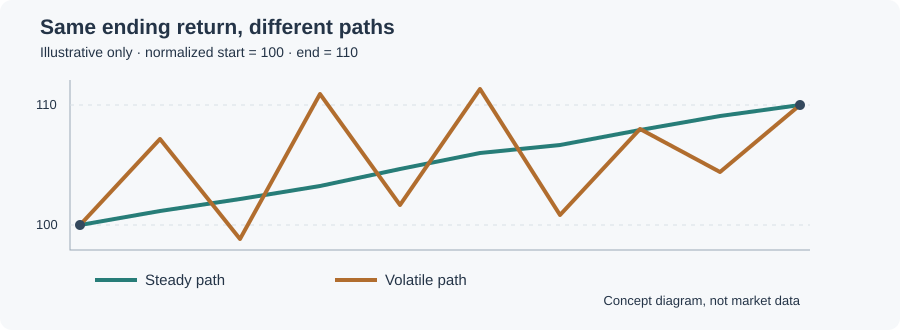

# Finance & Data Analytics Portfolio

**Sogang University · Mathematics | QUANTIFI · 2026 Fall**

수학적 사고를 바탕으로 추상적인 아이디어를 검증 가능한 가설로 구체화하고, Python과 생성형 AI를 활용해 데이터 분석, 판단 규칙 설계, 구현 및 성능 검증을 수행했습니다. 본 포트폴리오는 QUANTIFI에서 진행한 네 차례의 팀 연구를 바탕으로, 투자 성과뿐 아니라 데이터에서 의미를 발견하고 실험을 통해 해결책을 발전시킨 과정에 중점을 두었습니다.

## Selected Problem-Solving Experiences | 주요 문제 해결 경험

### 01. 데이터 간 관계를 활용한 새로운 정보 추출
**Data Interpretation · Feature Engineering | [Project 02 — Shareholder Yield](02-shareholder-yield/)**

**문제 상황.** 기업의 주주환원 수준은 배당만으로 판단하기 어렵습니다. 발행주식수 변화도 중요하지만, 액면분할·무상증자처럼 경제적 가치 변화 없이 발생하는 기계적 변동을 그대로 반영하면 지표의 해석이 왜곡될 수 있습니다.

**해결 과정.**

1. 시가총액 = 주가 × 발행주식수라는 변수 간 관계에 주목했습니다.
2. 시가총액을 원 단위로 바꾼 뒤 배당 미반영 수정주가로 나누어 수정주식수 대용치를 역산했습니다.
3. 수정주식수 대용치의 12개월 로그 변화율(NSI)과 배당수익률(DY)을 결합해 주주환원 지표(SY)를 설계했습니다.

$$N_{i,t}=\frac{MarketCap_{i,t}\times 10^6}{AdjustedPrice_{i,t}}$$

(시가총액 입력 단위: 백만원, 수정주가: 원)

$$NSI_{i,t}=\ln\left(\frac{N_{i,t-1}}{N_{i,t-13}}\right),\qquad SY_{i,t}=DY_{i,t}-NSI_{i,t}$$

**검증 사례.** 2018년 5월 삼성전자 50:1 액면분할을 대상으로 지표의 작동을 점검했습니다. 팀 발표자료에 따르면 수정주식수 대용치는 2017년 6월 65.33억주, 2018년 6월 64.19억주, 2018년 12월 59.70억주로 나타났습니다. 원 발행주식수의 분할에 따른 급증과 달리 대용치는 연속적인 수준을 유지했습니다. 실제 소각량과 직접 대조한 완전한 검증은 아닙니다.

**검증 및 배운 점.** 회귀분석, 필터 제거 및 민감도 실험으로 지표의 유효성을 검토했습니다. 데이터에 원하는 변수가 직접 존재하지 않아도 변수의 정의와 관계를 이용하여 분석 목적에 맞는 정보를 도출할 수 있음을 배웠습니다. 수정주식수는 대용치이며 실제 발행주식수·자사주 소각액을 직접 측정한 값은 아닙니다.

[상세 연구 및 수식](02-shareholder-yield/) · [검증 차트](02-shareholder-yield/#대표-차트--20260918-팀-발표본) · [Python Notebook](02-shareholder-yield/backtest.ipynb)

---

### 02. 하나의 시계열 데이터에서 네 가지 통계적 특성 추출
**Statistical Feature Engineering · Decision Rule Design | [Project 04 — PAS](04-price-asymmetric-strategy/)**

**문제 상황.** 동일한 기간에 같은 10%의 수익률을 기록한 두 종목이라도, 꾸준히 상승한 종목과 급등락을 반복한 종목의 특성은 다릅니다. 단순 수익률만으로는 가격 변화 과정의 차이를 설명하기 어렵다고 보았습니다.



*가상 경로를 이용한 개념 설명용 그림이며, 실제 금융 데이터나 백테스트 결과가 아닙니다.*

**해결 과정.** 일별 수정주가가 시간 순서를 가진 데이터라는 점에 주목하여 다음 네 가지 통계적 특성을 추출했습니다.

| 특성 | 추출한 정보 |
| --- | --- |
| Momentum | 중기 가격 추세의 방향과 강도 |
| Volatility | 최근 126거래일 일간 수익률의 변동성 |
| Skewness | 최근 126거래일 일간 수익률 분포의 비대칭성 |
| Sharpe proxy | 최근 126거래일 일간 수익률 평균 / 표준편차 |

각 통계량을 종목 간 상대 순위로 변환해 단위와 범위의 차이를 줄였습니다. 매수와 공매도의 판단 목적에 맞춰 서로 다른 점수식을 설계하고 Python으로 구현했습니다.

**검증 및 결과.** Rolling IC, Signal Decay, 백테스트 및 체결 조건별 비교를 수행했습니다.

| 5일 체결 조건 (팀 전략설명서) | 전략 | KOSPI200 |
| --- | ---: | ---: |
| CAGR | 21.6% | 15.4% |
| Sharpe | 1.14 | 0.57 |
| MDD | -13.6% | -35.9% |

**배운 점.** 데이터의 양뿐 아니라 어떤 관점에서 해석하고 판단 규칙으로 구조화하는지가 중요하다는 점을 경험했습니다. 네 핵심 피처는 수정주가에서 추출했으며, 체결 검토·성과 측정에는 시총·거래대금 등 추가 데이터도 사용했습니다. 위 성과는 팀 보고값이며 독립 재실행 결과가 아닙니다.

[상세 연구 및 판단 규칙](04-price-asymmetric-strategy/) · [Python Notebook](04-price-asymmetric-strategy/backtest.ipynb)

---

### 03. 실험 결과를 바탕으로 기존 접근 방식 재검토
**Data Integration · Quality Validation · Iterative Problem Solving | [Project 03 — PAS + Export](03-export-enhanced-pas/)**

**문제 상황.** 기존 가격 기반 전략에 기업의 수출 정보를 추가하면 예측력과 위험 조정 성과를 개선할 수 있을지 검토했습니다.

### 데이터 구축에서 전략 재검토까지

| 단계 | 시도 및 판단 |
| --- | --- |
| 1. 기업별 데이터 수집 | 팀원들과 DART 사업보고서에서 기업별 수출액 수집을 시도하고, 한국무역협회(K-stat) 통계와 관련 데이터 문의, 통계청 분류 기준, FnGuide 기업별 산업분류를 활용해 연결 방법을 조사 |
| 2. 산업분류 매핑 | 서로 다른 분류 체계의 데이터를 연결. 당시 팀 내부 설명 기준 매핑 성공률 약 90%, 미매핑 약 10% |
| 3. 활용 적합성 검토 | 연결 이후 데이터 적합도 약 60%대에 그쳐 최초 기업별 구축안을 폐기 |
| 4. 대안 구성 | K-stat 품목별 월간 수출을 FnGuide 산업분류에 연결하는 산업별 접근으로 변경 |
| 5. 비교 실험 | 수출 증가율의 변화(Export Shock)를 1개월 지연해 반영하고 기존 가격 신호와 50:50 결합 |
| 6. 연구 방향 변경 | 위험 지표는 일부 개선됐으나 최대낙폭은 여전히 높고 연환산 수익률은 소폭 감소. 최종 채택하지 않고 후속 가격 신호 재설계 연구로 전환 |

> 초기 매핑·적합도 수치는 당시 팀 내부 설명에 따른 근사치다. 정확한 분모, 적합성 판정 기준 및 산출 원자료는 현재 확인되지 않았다. 적합도 60%대를 결측률·오류율로 해석하지 않는다.

**최종 분석에 사용한 산업별 매핑** (팀 투자제안서 3·7·30쪽 기준)

| FnGuide 산업 | K-stat 수출 품목 |
| --- | --- |
| 반도체 | 반도체 |
| 자동차 및 부품 | 자동차 |
| 조선 | 선박 |
| 화학 | 석유화학 |
| 디스플레이 | 디스플레이 |
| 나머지 22개 산업 | 기존 가격 신호 유지 |

월평균 거래 가능 종목 302개 중 53.7개(제안서 보고 기준 17.5%)에 수출 신호를 반영했다. 이는 초기 기업별 매핑 성공률과 다른 지표이며, 나머지 82.5%는 매핑 실패율이 아니라 미적용 비율이다.

**실증 검증.** 수출 신호와 가격 신호의 결합 효과를 비교했습니다.

| 50:50 실험 | 가격 신호만 사용 | 수출 신호 추가 |
| --- | ---: | ---: |
| Net CAGR | 34.13% | 33.76% |
| Sharpe | 1.31 | 1.35 |
| MDD | -43.63% | -31.60% |

**배운 점.** 데이터를 연결하는 데 성공하는 것과 분석에 적합한 데이터를 확보하는 것은 다르며, 새로운 데이터가 언제나 더 나은 결과를 보장하지도 않습니다. 기존에 투입한 시간과 노력에 얽매이지 않고 실증 결과를 근거로 판단 기준을 재설계하는 방향을 택했습니다. 후속 Project 04는 전략 조건이 다른 연구로, 성과를 단순 전후 비교하지 않습니다.

[데이터 처리 및 상세 비교 실험](03-export-enhanced-pas/) · [Python Notebook](03-export-enhanced-pas/backtest.ipynb)

---

## Research & Projects | 전체 연구 목록

| Project | 연구 질문 | 핵심 역량 |
| --- | --- | --- |
| [01. Earnings Surprise & EPS Revision](01-earnings-revision/) | 서로 다른 관측주기·단위의 실적 및 전망 정보를 어떻게 결합할 수 있는가? | 데이터 정렬·통합, 시점 관리 |
| [02. Shareholder Yield](02-shareholder-yield/) | 기존 변수의 관계에서 필요한 정보를 역산해 새로운 지표를 설계할 수 있는가? | 데이터 해석, 피처 설계 |
| [03. PAS + Export Shock](03-export-enhanced-pas/) | 새로운 데이터의 추가가 기존 전략을 실제로 개선하는가? | 데이터 매핑, 품질 검토, 비교 실험 |
| [04. Price Asymmetric Strategy](04-price-asymmetric-strategy/) | 하나의 시계열에서 서로 다른 특성을 도출해 판단 규칙으로 발전시킬 수 있는가? | 통계적 피처 엔지니어링, 검증 |

## Core Competencies & Research Workflow

| 역량 | 연구 과정 |
| --- | --- |
| Data Analysis | 변수 정의·출처 파악, 결측·중복·단위 처리, 종목 및 날짜 정렬 |
| Decision Rule Design | 시점별 유니버스, 정보 이용 시차, 피처 산출, 신호 결합 |
| AI-Assisted Development | 생성형 AI 보조 도구를 활용한 Python 구현 및 코드 검토 |
| Testing & Validation | 회귀분석, 통계적 유의성, 비교 실험, 민감도 및 리스크 분석 |
| Documentation | 연구 결과와 한계 정리, Notebook 및 분석 조건 문서화 |

## Tools & interests

Python · pandas · NumPy · SciPy · statsmodels · Matplotlib · Jupyter Notebook · VS Code · Codex · Claude Code

Financial data analytics, statistical modeling, risk management, AI-assisted research workflows.

## Repository structure

```text
finance-research-portfolio/
├── README.md
├── assets/                         # 개념 설명용 시각 자료
├── 01-earnings-revision/           # 데이터 통합
├── 02-shareholder-yield/           # 정보 역산 및 지표 설계
├── 03-export-enhanced-pas/         # 대체 데이터 비교 실험
└── 04-price-asymmetric-strategy/   # 통계 피처와 판단 규칙
```

각 프로젝트에는 README와 기존 계산 로직을 보존한 backtest.ipynb가 있습니다. 02·04번에는 팀 발표자료의 확인 가능한 수치를 재구성한 검증 차트를 함께 게시합니다.

## Scope & transparency

- 모든 프로젝트는 QUANTIFI 팀 연구입니다. 3번 프로젝트의 데이터 확보·가공은 학회원들과 함께 진행했습니다.
- DataGuide에서 상장기업과 상장폐지 기업을 포함해 추출했으며 요인 데이터도 DataGuide를 사용했습니다. 상폐 수익률 처리까지 완전히 검증한 것은 아닙니다.
- 데이터 이용 가능 시점을 고려해 연구별로 시차를 적용했습니다(01: 두 신호 3개월, 02: DPS 15개월, 03: 수출 1개월, 04: 과거 가격 관측값). 실제 공시·발표 시점과 완전히 일치하는지 추가 검증이 필요합니다.
- 원천 금융 데이터(Excel/CSV), 내부 보고서 및 발표자료는 게시하지 않습니다. 공개 범위와 이용 권한을 확인한 자료만 추가할 예정입니다.
- 성과는 저장된 실행 결과 또는 팀 보고값이며, 독립 재실행이나 실거래 성과가 아닙니다. 프로젝트별 코드·데이터 가용성 및 재현 한계는 각 README에 설명했습니다.
